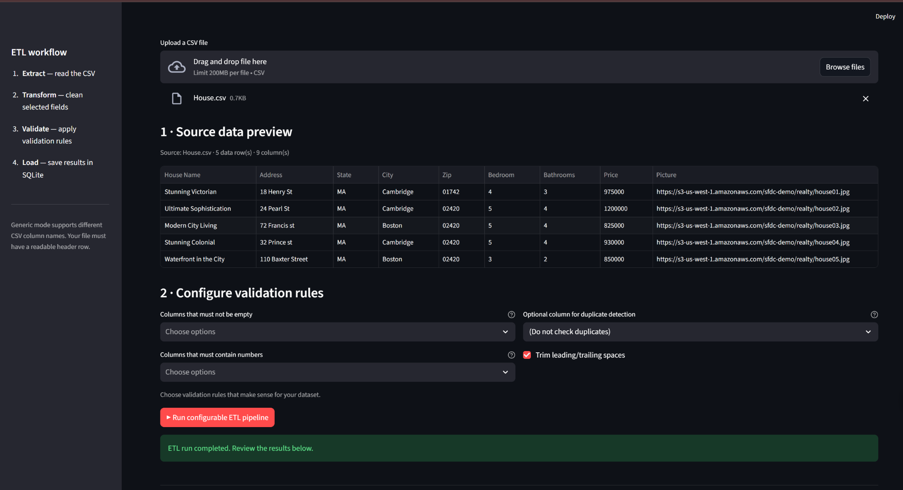
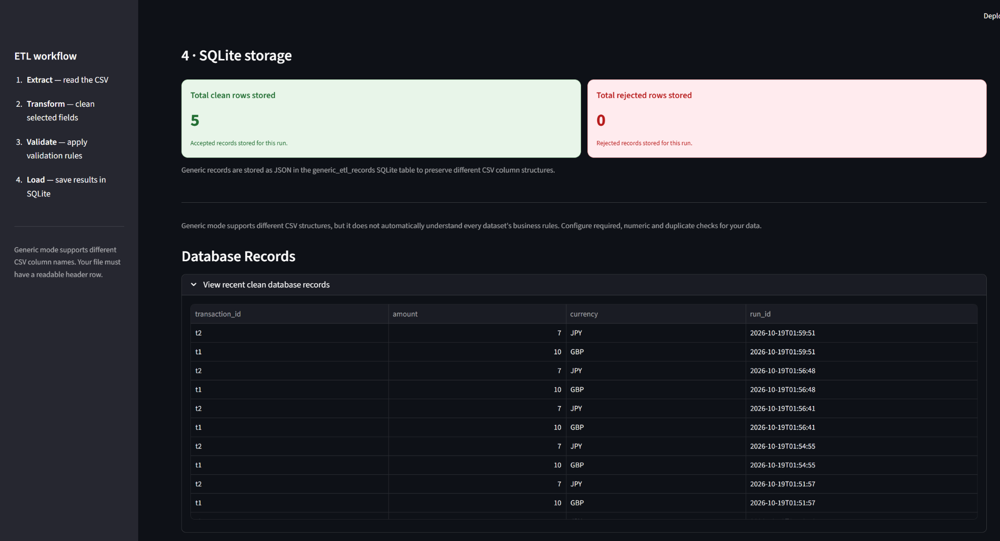

# Flexible ETL Data Processing and Monitoring Dashboard

A Python-based ETL (Extract, Transform, Load) application that processes CSV datasets, applies configurable data-quality checks, separates accepted and rejected records, and provides an interactive Streamlit dashboard to monitor processing results. SQLite is used to store transaction-mode results for database verification.

## Table of Contents

- [Project Overview](#project-overview)
- [Problem Statement](#problem-statement)
- [Objectives](#objectives)
- [Features](#features)
- [Technologies Used](#technologies-used)
- [System Architecture](#system-architecture)
- [ETL Workflow](#etl-workflow)
- [Processing Modes](#processing-modes)
- [Validation Rules](#validation-rules)
- [Dashboard Screenshots](#dashboard-screenshots)
- [Project Structure](#project-structure)
- [Installation and Setup](#installation-and-setup)
- [How to Run the Application](#how-to-run-the-application)
- [How to Use the Dashboard](#how-to-use-the-dashboard)
- [Sample Input and Expected Results](#sample-input-and-expected-results)
- [Database Storage](#database-storage)
- [Output Files](#output-files)
- [Error Handling and Limitations](#error-handling-and-limitations)
- [Future Enhancements](#future-enhancements)
- [Learning Outcomes](#learning-outcomes)
- [Author](#author)

## Project Overview

The Flexible ETL Data Processing and Monitoring Dashboard is designed to demonstrate how raw CSV data can be processed into a cleaner, more usable format through a structured data pipeline.

In real-world applications, datasets may contain missing values, duplicate records, invalid numeric values, inconsistent formatting, or other data-quality problems. Processing such data manually can be time-consuming and error-prone.

This project provides an interactive interface where users can preview CSV data, select a processing mode, execute the pipeline, inspect accepted and rejected records, review summary metrics, and download cleaned data.

The application combines Python-based data processing with a Streamlit dashboard and SQLite database storage.

## Problem Statement

Raw datasets often contain inconsistencies that make them unsuitable for analysis or further processing. Applications that consume this data need a reliable way to identify invalid records and distinguish them from records that pass the selected validation rules.

The goal of this project is to build a simple, interactive ETL application that demonstrates data extraction, transformation, validation, and loading while making the results visible to users.

## Objectives

- Build an ETL pipeline for CSV data processing.
- Provide a browser-based interface for uploading and previewing datasets.
- Support generic CSV processing with user-selected validation checks.
- Retain a transaction-specific mode with predefined validation rules.
- Separate accepted records from rejected records.
- Display processing metrics, including input, accepted, and rejected row counts.
- Allow users to inspect rejection reasons where available.
- Store transaction-mode results in an SQLite database.
- Provide downloadable cleaned CSV output.

## Features

### 1. CSV Upload and Preview

- Upload a CSV file through the Streamlit interface.
- Preview source data before processing.
- Display the input row count and number of columns.
- Use the included sample dataset to test the application.

### 2. Flexible CSV Processing

The generic processing mode supports CSV datasets with different column names and structures, provided the file is readable and contains a header row.

Users can select appropriate validation checks and fields based on the dataset.

The application does not automatically understand the meaning of every column. The selected rules must match the dataset being processed.

### 3. Transaction Validation

The transaction mode applies the original project's transaction-specific validation rules, including transaction ID checks, amount validation, currency validation, and duplicate transaction ID detection.

### 4. Accepted and Rejected Records

After processing, records are separated into:

- **Accepted records:** Records that pass the selected validation rules.
- **Rejected records:** Records that fail one or more validation rules.

The dashboard allows users to inspect the results. Rejection reasons are available for the transaction-specific validation workflow.

### 5. Interactive Dashboard

The Streamlit interface presents:

- Source data preview.
- Processing status.
- Input row count.
- Accepted row count.
- Rejected row count.
- Acceptance rate.
- Accepted and rejected record tables.
- Data profiling information, where supported.
- SQLite storage totals and recent database records in transaction mode.

### 6. Downloadable Output

Users can download the cleaned CSV generated by the processing run and use it for further analysis or processing.

### 7. SQLite Database Verification

In transaction mode, the application stores accepted and rejected transaction records in SQLite. The dashboard displays stored-record counts and provides expandable sections for inspecting recent database records.

## Technologies Used

| Technology | Purpose |
|---|---|
| Python | Core programming language |
| Streamlit | Interactive web dashboard |
| Pandas | CSV and tabular data processing |
| SQLite | Local relational database storage |
| SQL | Table creation, data loading, and querying |
| CSV | Input and output data format |
| Git and GitHub | Version control and source code hosting |

## System Architecture

The application follows a straightforward ETL architecture.

```text
             CSV Dataset
                  |
                  v
           1. EXTRACT
       Read and preview data
                  |
                  v
          2. TRANSFORM
     Normalize selected fields
       and prepare records
                  |
                  v
           3. VALIDATE
      Apply selected data rules
                  |
           +------+------+
           |             |
           v             v
     Accepted Data   Rejected Data
           |             |
           +------+------+
                  |
                  v
             4. LOAD
       Save supported outputs
                  |
          +-------+-------+
          |               |
          v               v
    Clean CSV Output   SQLite Storage
                       (transaction mode)
          |
          v
   Streamlit Dashboard
   Results and Metrics
```

The generic and transaction modes have different validation and storage behavior. SQLite storage described above applies to the transaction-specific workflow.

## ETL Workflow

### Step 1: Extract

The application reads the uploaded CSV file or the included sample dataset.

It displays a preview so users can inspect the column names and records before running the pipeline.

### Step 2: Transform

The application prepares the data for validation. Depending on the selected processing mode and fields, this may include normalizing selected values and preparing records for the applicable checks.

### Step 3: Validate

The application applies the configured checks in generic mode or the predefined transaction rules in transaction mode.

Records are categorized as accepted or rejected according to the checks performed.

### Step 4: Load

The application presents the results through the dashboard and makes the cleaned CSV available for download.

In transaction mode, accepted and rejected records are also stored in SQLite so the stored data can be verified.

## Processing Modes

### Generic CSV Mode

Generic mode is designed for datasets that do not follow the original transaction schema.

It can be used to explore CSV files containing student, customer, inventory, sales, or other tabular data, provided the applicable fields and validation checks are configured appropriately.

The actual validation behavior depends on the selected checks. A successful run does not necessarily mean that every business-specific rule for the dataset has been satisfied.

### Transaction Mode

Transaction mode retains the original transaction-specific rules and database workflow.

It checks transaction IDs, numeric amounts, three-letter currency codes, and duplicate transaction IDs according to the implemented validation logic.

This mode is useful for demonstrating a complete ETL workflow with predefined rules and persistent SQLite storage.

## Validation Rules

The following transaction-specific checks are implemented in the original pipeline.

| Check | Purpose |
|---|---|
| Transaction ID validation | Identifies missing or invalid transaction IDs |
| Amount validation | Checks whether the amount is a valid numeric value |
| Currency validation | Checks the currency field against the expected three-letter format |
| Duplicate detection | Identifies duplicate transaction IDs within a processing run |
| Rejection tracking | Records why a transaction was rejected |

The exact rules and rejection behavior are determined by the implementation in `etl.py`. Generic mode uses the validation checks selected for the uploaded dataset.

## Dashboard Screenshots

Screenshots help users understand the application without running it first.

Create a folder named `screenshots` in the repository and add screenshots of your actual working dashboard.

### 1. Main Dashboard and CSV Preview



*Shows the application interface, processing modes, CSV upload area, and source data preview.*

### 2. ETL Run Summary


*Shows the input, accepted, and rejected row counts, acceptance rate, and processed records.*

### 3. SQLite Database Verification



*Shows the transaction-mode database totals and the expandable sections for recent clean and rejected records.*

**Note:** The screenshot paths above are placeholders. Add your own screenshots using these filenames, or change the Markdown paths to match your actual filenames.

## Project Structure

```text
Flexible-ETL-Data-Processing-and-Monitoring-Dashboard/
│
├── app.py
├── etl.py
├── sqlite_load.py
├── requirements.txt
├── README.md
├── raw.csv
├── raw_bad.csv
├── queries.sql
├── analytics_queries.sql
├── model_schema.sql
├── model_load.sql
├── model_verification.sql
│
├── docs/
│   ├── model_design.md
│   └── project_walkthrough.md
│
├── tests/
│
├── .github/
│   └── workflows/
│
└── screenshots/
    ├── dashboard-preview.png
    ├── etl-run-summary.png
    └── sqlite-database.png
```

The structure above describes the main project files and intended screenshot folder. Keep only files and folders that actually exist in your repository. The `screenshots/` folder must be created and populated separately if it does not already exist.

### Important Files

- `app.py` — Streamlit dashboard and user interface.
- `etl.py` — ETL processing and validation logic.
- `sqlite_load.py` — SQLite database initialization and transaction result loading.
- `requirements.txt` — Python package dependencies.
- `raw.csv` — Sample transaction dataset.
- `raw_bad.csv` — Sample data containing invalid records.
- `queries.sql` — SQL queries used by the project.
- `analytics_queries.sql` — Additional SQL analytics queries.
- `model_schema.sql`, `model_load.sql`, and `model_verification.sql` — SQL scripts for the project's documented database workflow.

## Installation and Setup

### Prerequisites

Install the following before running the application:

- Python 3.10 or a compatible Python version supported by the dependencies.
- Git, if you want to clone the repository.
- A code editor such as Visual Studio Code.
- A modern web browser.

### Step 1: Clone the Repository

Open a terminal and run:

```bash
git clone https://github.com/shanmukpanchireddi/Flexible-ETL-Data-Processing-and-Monitoring-Dashboard.git
```

Navigate into the cloned project directory. If the repository contains a nested project folder, enter the directory containing `app.py` and `requirements.txt`.

### Step 2: Create a Virtual Environment

On Windows:

```powershell
python -m venv .venv
```

Activate it:

```powershell
.\.venv\Scripts\Activate.ps1
```

If PowerShell blocks activation, you can run the environment's Python executable directly instead.

### Step 3: Install Dependencies

Run this command from the folder containing `requirements.txt`:

```powershell
python -m pip install -r requirements.txt
```

### Step 4: Start the Dashboard

Run:

```powershell
python -m streamlit run app.py
```

Streamlit will display a Live Demo, usually:

```text
https://shanmuk.streamlit.app
```

Open the displayed URL in your browser.

## How to Use the Dashboard

1. Start the Streamlit application.
2. Choose Generic CSV mode or Transaction mode.
3. Upload a CSV file, or select the included sample dataset if that option is available.
4. Inspect the source data preview.
5. In generic mode, configure the validation checks and fields appropriate for your data.
6. In transaction mode, review the predefined transaction validation rules.
7. Click the relevant **Run ETL pipeline** button.
8. Review the run summary and accepted records.
9. Inspect rejected records and their rejection reasons where available.
10. Download the cleaned CSV.
11. In transaction mode, inspect the SQLite storage totals and recent database records.

## Sample Input and Expected Results

The included `raw.csv` file contains sample transaction data with valid records, duplicate IDs, a missing ID, and an invalid amount.

Example:

```csv
transaction_id,amount,currency
t1,10,gbp
t2,7,jpy
t2,7,jpy
,5,usd
t3,12x,eur
```

When processed using the transaction-specific rules, the expected classification is:

| Record | Issue | Result |
|---|---|---|
| `t1,10,gbp` | Valid transaction | Accepted |
| `t2,7,jpy` | First occurrence of the ID | Accepted |
| `t2,7,jpy` | Duplicate ID in the same run | Rejected |
| `,5,usd` | Missing transaction ID | Rejected |
| `t3,12x,eur` | Invalid numeric amount | Rejected |

Expected summary for this sample:

- Input rows: 5
- Accepted rows: 2
- Rejected rows: 3
- Acceptance rate: 40%

These results apply to the sample data and transaction-specific rules. Different input data or configured validation rules can produce different results.

## Database Storage

The transaction-mode workflow uses SQLite, a lightweight relational database that stores data in a local database file.

The project creates tables for accepted and rejected transactions. The schema includes transaction fields, run identifiers, and rejection reasons where applicable.

The dashboard displays stored-record totals and allows users to inspect recent records.

Database totals can include records from previous runs. Therefore, the number of records stored in SQLite may be greater than the number processed in the most recent run.

Generic CSV mode should not be assumed to use the same transaction-specific storage schema.

## Output Files

Depending on the selected processing mode, the application can provide:

- A cleaned CSV containing accepted records.
- A set of rejected records available for inspection.
- Run summary metrics.
- Rejection reasons for transaction-mode records.
- SQLite-stored transaction results in transaction mode.

The cleaned CSV is intended to provide a more consistent dataset for downstream analysis.

## Error Handling and Limitations

- Uploaded files must be readable CSV files with a header row.
- The CSV columns must be appropriate for the selected validation rules.
- Generic mode does not automatically infer every dataset's business meaning.
- Validation results depend on the configured checks and implemented rules.
- Transaction-specific validation is designed for the original transaction schema.
- SQLite storage and database verification apply to transaction mode.
- Local database totals can accumulate across multiple runs.
- The application is a demonstration project and is not intended to replace a production-grade data integration platform.
- The application runs locally unless separately deployed to a hosting service.

## Future Enhancements

Possible improvements include:

- Add support for Excel files and additional input formats.
- Provide configurable rules for missing values, data types, and duplicate handling.
- Add more detailed data-quality reports.
- Support configurable database schemas for generic datasets.
- Add data visualizations for record quality and validation results.
- Add automated unit and integration tests.
- Add user authentication and access controls.
- Deploy the dashboard to a cloud hosting platform.
- Add automated CI checks and deployment workflows.

These are potential enhancements and should not be considered implemented features unless they are added to the code.

## Learning Outcomes

This project demonstrates practical experience with:

- ETL pipeline design.
- CSV ingestion and data cleaning.
- Data validation and rejection handling.
- Python application development.
- Streamlit dashboard development.
- SQLite database operations.
- SQL-based data inspection.
- Separating data-processing logic from the user interface.
- Version control and project documentation.

## Author

**Shanmukha Rao Panchireddi**

GitHub: [@shanmukpanchireddi](https://github.com/shanmukpanchireddi)

Project Repository: [Flexible ETL Data Processing and Monitoring Dashboard](https://github.com/shanmukpanchireddi/Flexible-ETL-Data-Processing-and-Monitoring-Dashboard)

---

If you find this project useful for learning ETL concepts, CSV data processing, Python, or Streamlit dashboards, feel free to explore the source code and adapt it for educational purposes.
