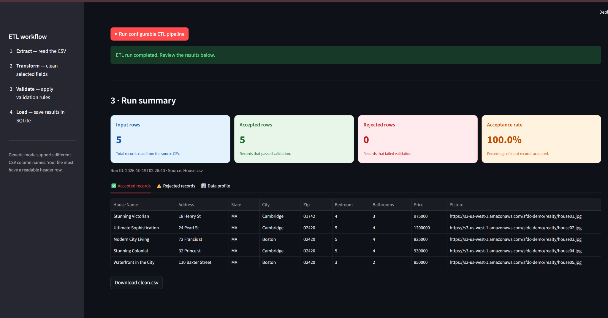

# Flexible ETL Data Processing and Monitoring Dashboard

An interactive ETL (Extract, Transform, Load) application built with Python, Pandas, Streamlit, and SQLite. The dashboard allows users to upload CSV datasets, validate and clean records, identify data-quality issues, monitor processing results, and download accepted and rejected data.

**Live Demo:** https://shanmuk.streamlit.app/

**GitHub Repository:** https://github.com/shanmukpanchireddi/Flexible-ETL-Data-Processing-and-Monitoring-Dashboard

---

## Table of Contents

1. [Project Overview](#1-project-overview)
2. [Problem Statement](#2-problem-statement)
3. [Project Objectives](#3-project-objectives)
4. [Technologies Used](#4-technologies-used)
5. [System Architecture](#5-system-architecture)
6. [Project Workflow](#6-project-workflow)
7. [Application Features](#7-application-features)
8. [Processing Modes](#8-processing-modes)
9. [Data Validation and Transformation](#9-data-validation-and-transformation)
10. [Database Design](#10-database-design)
11. [Screenshots](#11-screenshots)
12. [Project Structure](#12-project-structure)
13. [Installation and Setup](#13-installation-and-setup)
14. [How to Use the Dashboard](#14-how-to-use-the-dashboard)
15. [Output and Monitoring](#15-output-and-monitoring)
16. [Testing and Verification](#16-testing-and-verification)
17. [Deployment](#17-deployment)
18. [Limitations and Future Enhancements](#18-limitations-and-future-enhancements)
19. [Learning Outcomes](#19-learning-outcomes)
20. [Author](#20-author)

---

## 1. Project Overview

Data is often collected in CSV files from different applications and business systems. Before that data can be used for reporting or analytics, it may need to be cleaned, validated, transformed, and stored.

This project implements a small, interactive ETL workflow that helps users perform these tasks through a web-based dashboard.

The application supports two processing modes:

- **Generic CSV Mode:** Process different CSV datasets using configurable validation rules.
- **Transaction Mode:** Process transaction data using predefined transaction-specific validation rules.

After processing, the application displays a summary of the results, separates accepted and rejected records, and provides downloadable CSV files. SQLite is used to store processing results.

The dashboard is deployed using Streamlit Community Cloud.

## 2. Problem Statement

Raw datasets can contain missing values, duplicate records, invalid numeric values, inconsistent formatting, and other quality issues.

Handling these issues manually can be repetitive and error-prone. It can also be difficult to determine how many records passed validation, which records failed, and why they were rejected.

The objective of this project is to develop a simple ETL monitoring dashboard that makes data validation and processing results easier to inspect.

## 3. Project Objectives

- Build an interactive dashboard for uploading CSV datasets.
- Preview input data before processing.
- Implement configurable validation for generic datasets.
- Implement predefined validation for transaction datasets.
- Identify invalid and duplicate records.
- Clean selected formatting issues, such as surrounding whitespace.
- Separate accepted and rejected records.
- Display processing summaries and data-quality information.
- Allow users to download the processing results.
- Store processing results in an SQLite database.
- Deploy the dashboard so that it can be accessed through a public URL.

## 4. Technologies Used

| Technology | Purpose |
|---|---|
| Python | Main programming language |
| Pandas | CSV handling, DataFrame operations, cleaning, and validation |
| Streamlit | Interactive dashboard and web interface |
| SQLite | Local relational database for storing processing results |
| SQL | Database schema, queries, and data verification |
| Git | Version control |
| GitHub | Source code hosting and project documentation |
| Streamlit Community Cloud | Public dashboard deployment |

## 5. System Architecture

The application follows a straightforward ETL workflow.

```text
             USER
              |
              v
       Streamlit Dashboard
              |
              v
        Upload CSV File
              |
              v
       Preview Input Data
              |
              v
       Select Processing Mode
          /          \
         /            \
        v              v
  Generic CSV      Transaction
     Mode              Mode
        \              /
         \            /
              v
      Validate and Clean
              |
              v
      Separate the Records
          /          \
         v            v
     Accepted       Rejected
      Records        Records
          \          /
           \        /
              v
       Processing Summary
              |
        +-----+------+
        |            |
        v            v
    CSV Downloads  SQLite Storage
```

The Generic CSV and Transaction modes use different validation logic. The selected mode determines how records are checked and stored.

## 6. Project Workflow

### Step 1: Upload the dataset

The user uploads a CSV file through the Streamlit interface. Sample CSV files are also included in the repository for trying the transaction workflow.

### Step 2: Preview the source data

The application reads the CSV into a Pandas DataFrame and displays a preview so the user can inspect its columns and records.

### Step 3: Choose the processing mode

The user selects either Generic CSV Mode or Transaction Mode.

### Step 4: Configure or apply validation rules

In Generic CSV Mode, the user configures relevant validation settings, including required fields and numeric fields.

In Transaction Mode, the application applies its predefined transaction-specific rules.

### Step 5: Clean and validate records

The application performs the checks associated with the selected mode. Records that pass the applicable checks are accepted; records that fail are rejected with validation information.

### Step 6: Review the results

The dashboard displays processing metrics, accepted records, rejected records, and relevant data-quality information.

### Step 7: Download the results

The user can download the accepted and rejected records as CSV files.

### Step 8: Store and inspect results

The application writes processing results to SQLite using the storage logic associated with the selected processing mode.

## 7. Application Features

### CSV Upload and Preview

- Upload CSV datasets through the dashboard.
- Preview source records before processing.
- Inspect the dataset's columns and structure.

### Configurable Validation

- Configure required fields in Generic CSV Mode.
- Configure numeric fields to validate.
- Detect duplicate records using the selected validation logic.
- Identify records that fail the configured checks.

### Data Cleaning

- Trim surrounding whitespace where applicable.
- Apply the transformations implemented for the selected mode.
- Separate accepted records from rejected records.

### ETL Monitoring

- View processing summary cards.
- Review accepted and rejected record counts.
- Inspect data-quality information and validation outcomes.
- Review stored results through the dashboard's database section.

### CSV Downloads

- Download accepted records.
- Download rejected records.
- Inspect the output files independently of the dashboard.

### SQLite Persistence

- Store processing results in SQLite.
- Keep transaction results and generic records in their respective storage structures.
- Use SQL queries to inspect stored data.

## 8. Processing Modes

### 8.1 Generic CSV Mode

Generic CSV Mode is intended for CSV files with different column structures.

Instead of requiring every uploaded file to follow one fixed business schema, the user configures the relevant validation rules for the dataset.

The mode supports checks such as:

- Required-field validation.
- Numeric-field validation.
- Duplicate detection.
- Whitespace cleaning.
- Accepted and rejected record separation.

**Example:** Consider a CSV file containing `employee_id`, `name`, and `salary`. A user could configure `employee_id` and `name` as required fields and `salary` as a numeric field.

The application checks the records against the configured rules. It does not automatically infer every possible business rule from arbitrary column names.

### 8.2 Transaction Mode

Transaction Mode uses the transaction-specific validation implemented in the project.

The included `raw.csv` sample dataset can be used to explore the transaction workflow. The pipeline checks transaction records against its predefined requirements, processes valid records, and separates rejected records.

The included sample is designed to demonstrate issues such as duplicate transaction IDs, missing identifiers, and invalid amount values.

With the supplied sample data and the original validation logic, the expected result is **2 accepted records and 3 rejected records**.

This expected count applies to the supplied sample dataset and its corresponding validation rules, not to every uploaded file.

## 9. Data Validation and Transformation

Data validation helps determine whether a record satisfies the rules defined for its processing mode.

| Check | Purpose |
|---|---|
| Required-field validation | Identifies records with missing required values |
| Numeric validation | Identifies values that cannot be interpreted as valid numbers under the configured rules |
| Duplicate detection | Identifies duplicate records or identifiers according to the selected mode |
| Whitespace cleaning | Removes surrounding whitespace where implemented |
| Transaction-specific validation | Applies the project's predefined transaction requirements |

### Accepted Records

Accepted records pass the validation rules applied during the current run.

### Rejected Records

Rejected records fail one or more applicable checks. Where implemented, the application records information explaining the rejection.

Keeping accepted and rejected data separate makes it easier to inspect quality issues and correct source datasets.

**Important:** Validation rules differ between Generic CSV Mode and Transaction Mode. A rule enabled in one mode should not be assumed to apply identically in the other.

## 10. Database Design

SQLite is used for persistent storage of processing results.

### Transaction storage

The transaction workflow uses the following tables:

- `clean_transactions`: Stores accepted transaction records.
- `rejected_transactions`: Stores rejected transaction records.

The transaction storage code is implemented in `sqlite_load.py`.

### Generic CSV storage

Generic CSV records are stored in the `generic_etl_records` table. The generic storage implementation keeps the record data in JSON form so that different CSV column structures can be represented.

### Database workflow

1. Process the uploaded dataset.
2. Separate accepted and rejected records.
3. Pass the relevant results to the storage functions.
4. Persist the records in the corresponding SQLite tables.
5. Inspect stored results using SQL queries or the dashboard's supported database views.

The generic and transaction workflows use different storage structures. The transaction tables should not be assumed to contain generic-mode records.

## 11. Screenshots

The following screenshots illustrate the main parts of the application.

### Dashboard and Source Data Preview


This screenshot shows the dashboard and an example of the source dataset before or during processing.

### ETL Run Summary



This screenshot shows the processing summary and the results displayed by the dashboard.

### SQLite Storage


This screenshot shows the database-related section and stored processing results.

## 12. Project Structure

```text
Flexible-ETL-Data-Processing-and-Monitoring-Dashboard/
│
├── app.py                  # Streamlit dashboard and user workflow
├── etl.py                  # Transaction-specific ETL and validation logic
├── sqlite_load.py          # Transaction SQLite storage functions
├── etl.db                  # Local SQLite database file
│
├── raw.csv                 # Sample transaction dataset
├── raw_bad.csv             # Sample dataset containing problematic data
│
├── model_schema.sql        # Database schema SQL
├── model_load.sql          # Database loading SQL
├── model_verification.sql  # Database verification SQL
├── analytics_queries.sql   # Analytics-related SQL queries
├── queries.sql             # Additional SQL queries
│
├── requirements.txt        # Python dependencies
├── README.md               # Project documentation
├── .gitignore              # Files excluded from Git
│
├── screenshots/
│   ├── dashboard-preview.png
│   ├── etl-run-summary.png
│   └── sqlite-database.png
│
├── tests/                  # Project tests
├── docs/                   # Supporting documentation
└── .github/                # GitHub-related configuration
```

The structure above describes the main files and directories. Additional files may be present in the repository.

## 13. Installation and Setup

Follow these steps to run the project on your own computer.

### Prerequisites

Install:

- Python.
- Git, if you want to clone the repository.
- A code editor such as Visual Studio Code.

### Step 1: Clone the repository

Open a terminal and run:

```bash
git clone https://github.com/shanmukpanchireddi/Flexible-ETL-Data-Processing-and-Monitoring-Dashboard.git
```

### Step 2: Enter the project directory

```bash
cd Flexible-ETL-Data-Processing-and-Monitoring-Dashboard
```

### Step 3: Create a virtual environment

On Windows:

```powershell
python -m venv .venv
```

Activate it:

```powershell
.\.venv\Scripts\Activate.ps1
```

If PowerShell does not allow activation, use a Command Prompt terminal and run:

```bat
.venv\Scripts\activate.bat
```

### Step 4: Install dependencies

```bash
python -m pip install -r requirements.txt
```

### Step 5: Start the dashboard

```bash
python -m streamlit run app.py
```

### Step 6: Open the local application

Streamlit will display a local URL in the terminal, typically:

```text
http://localhost:8501
```

Open the displayed URL in your browser.

## 14. How to Use the Dashboard

1. Open the live application or start it locally.
2. Upload a CSV file.
3. Preview the source dataset.
4. Select Generic CSV Mode or Transaction Mode.
5. In Generic CSV Mode, configure the validation settings appropriate for the uploaded dataset.
6. Run the processing workflow using the dashboard's controls.
7. Review the accepted and rejected record counts.
8. Inspect the resulting records and data-quality information.
9. Download the accepted and rejected CSV files as needed.
10. Review the available SQLite storage information.

For an initial test, use `raw.csv` to explore the transaction workflow. Use another CSV with a different column structure to explore the configurable Generic CSV Mode.

## 15. Output and Monitoring

The dashboard provides several useful outputs.

| Output | Description |
|---|---|
| Processing summary | Shows the results of an ETL run |
| Accepted records | Records that pass the applicable validation rules |
| Rejected records | Records that fail one or more applicable checks |
| Data-quality information | Helps users inspect issues in the dataset |
| Clean CSV download | Downloadable accepted data |
| Rejected CSV download | Downloadable rejected data |
| SQLite storage | Persistent storage for processing results |

The precise counts and validation outcomes depend on the uploaded dataset and the rules selected for the processing mode.

## 16. Testing and Verification

The repository includes a `tests/` directory for project tests and sample CSV files for exploring the workflows.

To run the tests, install the project dependencies and use:

```bash
python -m pytest
```

This command assumes that `pytest` is installed and that the repository's tests are configured to run with it. If it is not included in `requirements.txt`, install it separately before running the tests.

### Manual verification checklist

- [ ] The dashboard starts successfully.
- [ ] A CSV file can be uploaded and previewed.
- [ ] Generic CSV Mode accepts configurable validation settings.
- [ ] Transaction Mode processes the sample transaction dataset.
- [ ] Accepted and rejected records are separated.
- [ ] CSV download controls work.
- [ ] SQLite storage receives the relevant processing results.
- [ ] The screenshots display correctly on GitHub.
- [ ] The deployed application opens and can process a sample dataset.

## 17. Deployment

The dashboard is deployed using Streamlit Community Cloud.

**Live application:** https://shanmuk.streamlit.app/

To deploy your own copy:

1. Push the application source code to a GitHub repository.
2. Open Streamlit Community Cloud.
3. Connect the GitHub repository.
4. Select the appropriate branch and `app.py` as the application entry point.
5. Configure the Python dependencies from `requirements.txt`.
6. Deploy the application.
7. Open the generated public URL and test the main workflow.

Deployment availability and behavior depend on the hosting environment and its configuration.

**Storage note:** The SQLite database used by a locally running application is separate from the database used by a cloud deployment. A local database file should not be assumed to synchronize with the deployed app. Persistence of files written by a hosted application depends on the hosting environment.

## 18. Limitations and Future Enhancements

### Current scope

- CSV is the primary input format.
- Generic validation depends on the rules configured by the user.
- Transaction validation is based on predefined transaction-specific logic.
- The application is designed as a small interactive ETL demonstration rather than a distributed production data platform.
- Generic and transaction records use different SQLite storage structures.

### Potential future enhancements

- Support for Excel, JSON, and additional data formats.
- More configurable validation rules.
- Improved validation error categorization.
- ETL run history and comparison across runs.
- Additional charts for data-quality trends.
- More comprehensive automated tests.
- Persistent managed database storage for cloud deployment.
- Larger-dataset processing and performance improvements.

These are possible future improvements, not claims about existing functionality.

## 19. Learning Outcomes

This project provides practical experience with:

- Understanding the Extract, Transform, and Load workflow.
- Reading and manipulating CSV data with Pandas.
- Designing configurable data-validation logic.
- Handling duplicate, missing, and invalid values.
- Separating accepted and rejected records.
- Building interactive dashboards with Streamlit.
- Storing and inspecting data using SQLite and SQL.
- Organizing Python application code into separate modules.
- Using Git and GitHub for source-code management.
- Deploying a Python dashboard for public access.

## 20. Author

**Shanmukha Rao Panchireddi**

GitHub: https://github.com/shanmukpanchireddi

Project Repository: https://github.com/shanmukpanchireddi/Flexible-ETL-Data-Processing-and-Monitoring-Dashboard

Live Demo: https://shanmuk.streamlit.app/

---

If you find this project useful for learning Python, ETL workflows, CSV validation, SQL, or Streamlit dashboards, feel free to explore the source code and adapt it for educational purposes.